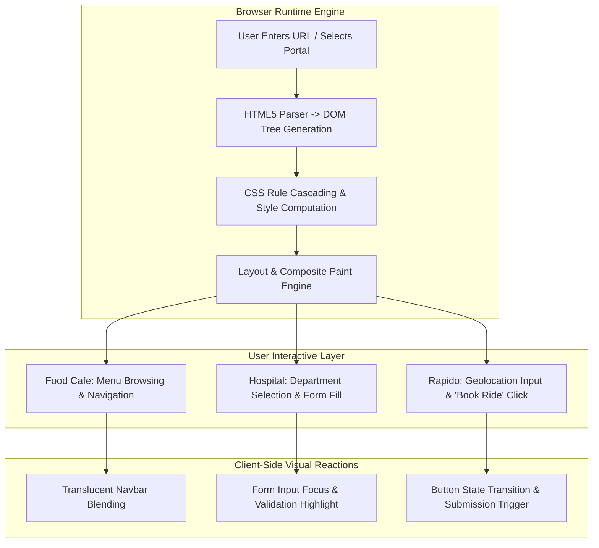

<div align="center">

<a href="https://github.com/akashvenkey/projects">

</a>


### 🔗 **Project Source Link:** [https://github.com/akashvenkey/projects](https://github.com/akashvenkey/projects)

[](https://github.com/akashvenkey/projects)
[](https://github.com/akashvenkey/projects.git)

[](https://developer.mozilla.org/en-US/docs/Web/HTML)
[](https://developer.mozilla.org/en-US/docs/Web/CSS)
[](https://developer.mozilla.org/en-US/docs/Learn/CSS/CSS_layout/Responsive_Design)
[](#)
[](#)

</div>

---

## 📌 Executive Summary & Overview

Clean, performant frontend web design demands an understanding of layout geometry, semantic structure, responsive viewport adaptations, and cross-browser visual fidelity. Building applications from foundational HTML and CSS without heavy framework overhead offers maximal control over rendering speeds, asset weight, and user engagement.

The **Web Application Suites** repository houses a collection of production-ready, interactive web application interfaces built with pure HTML5 and modern CSS3:
1. **Food Cafe Culinary Showcase (`food.html`):** A lifestyle dining website featuring semi-transparent navigation headers, warm culinary branding, and hero showcase styling.
2. **City Hospital Healthcare Portal (`hospital.html`):** A clinical healthcare directory providing quick links to key medical departments, outpatient services, doctor consultation details, and appointment inquiry forms.
3. **Rapido Urban Mobility Dispatcher (`rapido.html`):** An urban transit ride-booking interface modeled after Rapido, featuring pickup and drop-off geolocation input forms and rapid dispatch call-to-action buttons.

---

## 📑 Interactive Table of Contents

- [📌 Executive Summary & Overview](#-executive-summary--overview)
- [✨ Key Features & Capabilities](#-key-features--capabilities)
- [🖥 Application Showcase](#-application-showcase)
- [🏗 System Architecture & DOM Pipeline](#-system-architecture--dom-pipeline)
- [🛠 Tech Stack Breakdown](#-tech-stack-breakdown)
- [🚀 Reproducible Quickstart & Setup](#-reproducible-quickstart--setup)
- [📂 Project Directory Layout](#-project-directory-layout)
- [👨‍💻 Author & Contributions](#-author--contributions)

---

## ✨ Key Features & Capabilities

- **🍽 Food Cafe Portal:**
  - Styled translucent backdrop navigation bar with high-contrast golden brand accents (`color: rgb(213, 179, 100)`).
  - Background imagery integration with responsive viewport coverage (`background-size: cover`).
  - Fluid navigation routing for home, menu offerings, and reservation contacts.

- **🏥 City Hospital Portal:**
  - Distinctive clinical blue header navigation (`#1158aa`) with contrasting navigation links.
  - Multi-tier clinical sections highlighting primary emergency services and specialized consultation hours.
  - Structured form controls for patient data collection and scheduling requests.

- **🛵 Rapido Urban Mobility Portal:**
  - Clean branded navigation header showcasing core corporate and safety pillars.
  - Prominent "Bharat Moves On Rapido!" hero typography.
  - Interactive pickup and destination input elements with immediate "Book Ride" dispatch triggers.

---

## 🖥 Application Showcase

| Interface | Primary File | Core Functionality | Primary Styling Pattern |
| :--- | :--- | :--- | :--- |
| **Food Cafe** | `food.html` | Culinary branding, menu navigation & ambiance showcase | Translucent overlay, warm golden typography, full-bleed imagery |
| **City Hospital** | `hospital.html` | Clinical department directory, doctor profiles & appointments | Structured corporate blue palette, clean grid sections, accessible form controls |
| **Rapido Mobility** | `rapido.html` | Rapid ride dispatch, pickup & drop-off booking UI | High-contrast yellow/black branding, prominent input fields, focused CTA buttons |

---

## 🏗 System Architecture & DOM Pipeline

The following architectural flowchart demonstrates how the browser parses and executes each web suite interface:



---

## 🛠 Tech Stack Breakdown

| Category | Technology | Usage Description |
| :--- | :--- | :--- |
| **Markup Language** | HTML5 | Semantic structure (`<nav>`, `<header>`, `<div>`, `<input>`, `<button>`) |
| **Styling Engine** | CSS3 | Flexbox alignment, box-shadow depth, custom color palettes, and margin resets |
| **Assets & Media** | JPEG / Web Graphics | Background photography, brand icons, and visual UI assets |
| **Execution Tool** | Any Web Browser | Zero-compilation native rendering across desktop, tablet, and mobile devices |
| **Local Server** | Python / Node.js / Live Server | Quick local HTTP testing and live reloading |

---

## 🚀 Reproducible Quickstart & Setup

No compilers, build tools, or heavy node modules are required. You can preview all applications immediately:

### Option 1: Direct File Opening
Double click any `.html` file directly in Windows Explorer, or run in PowerShell:
```powershell
# Open Food Cafe
start "food.html"

# Open City Hospital
start "hospital.html"

# Open Rapido Urban Mobility
start "rapido.html"
```

### Option 2: Run a Local Static HTTP Server
```bash
# 1. Clone this repository
git clone https://github.com/akashvenkey/projects.git

# 2. Navigate to project directory
cd projects

# 3. Start a lightweight Python HTTP server
python -m http.server 8080

# 4. Open in your browser:
# http://localhost:8080/food.html
# http://localhost:8080/hospital.html
# http://localhost:8080/rapido.html
```

---

## 📂 Project Directory Layout

```plaintext
projects/
├── food.html       # Food Cafe culinary and dining showcase interface
├── hospital.html   # City Hospital clinical department and booking portal
├── rapido.html     # Rapido urban transit pickup/drop-off dispatch interface
├── Rapido.css      # External stylesheet for Rapido styling rules
└── README.md       # Interactive portal documentation and setup guide
```

---

## 👨‍💻 Author & Contributions

**Akash V**  
- **GitHub:** [@akashvenkey](https://github.com/akashvenkey)  
- **Focus:** Frontend Engineering, UI/UX Design & Full-Stack Systems  
- **Course:** Bachelor of Computer Applications (Hons), Alliance University  

Suggestions for UI enhancements, animations, or mobile responsive breakpoints are warmly welcomed. Don't forget to star ⭐ this repository if you enjoy these clean UI designs!

---

<div align="center">

<a href="https://github.com/akashvenkey/projects">

</a>


### 🔗 **Project Source Link:** [https://github.com/akashvenkey/projects](https://github.com/akashvenkey/projects)

[](https://github.com/akashvenkey/projects)
[](https://github.com/akashvenkey/projects.git)

</div>